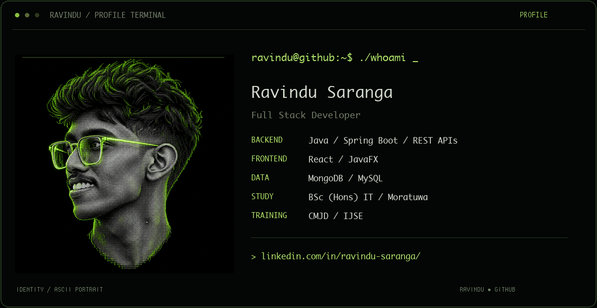
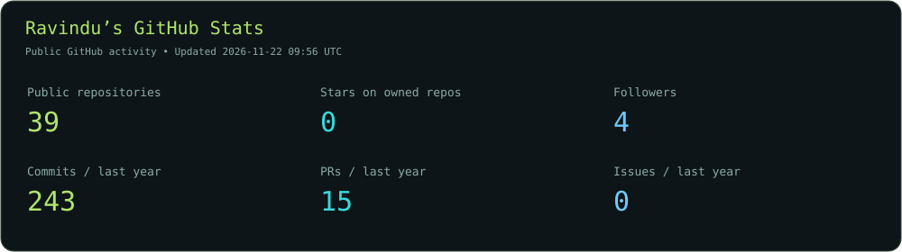
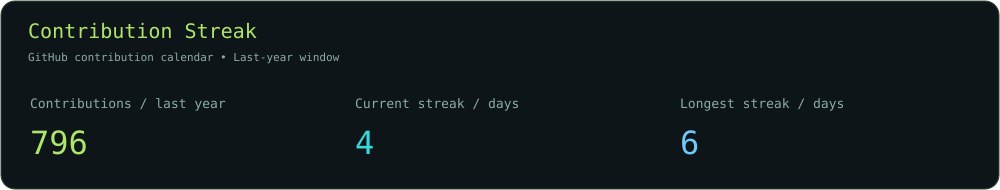
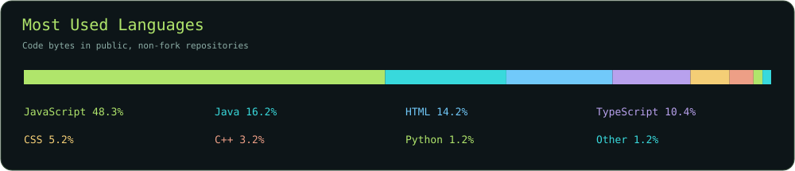
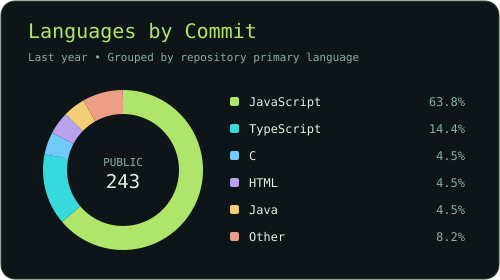
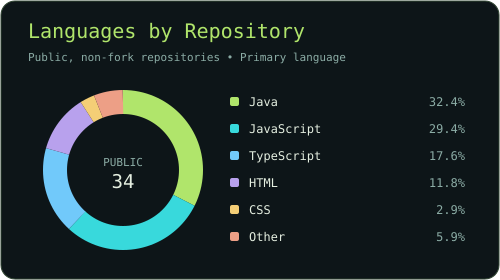

  <a href="#about-me">ABOUT</a> · <a href="#connect-with-me">CONNECT</a> · <a href="#tech-stack">TECH STACK</a> · <a href="#github-stats">STATS</a> · <a href="#language-insights">LANGUAGES</a> · <a href="#contribution-snake">SNAKE</a> · <a href="#support-my-work">SUPPORT</a>

<a href="https://www.linkedin.com/in/ravindu-saranga/">LinkedIn</a> · <a href="https://github.com/Ravindu200324511398?tab=repositories">Explore my repositories</a>

## About Me

### Hi, I'm Ravindu Saranga

I'm a **Full Stack Developer** based in Galle, Sri Lanka. I build web applications with **Java, Spring Boot, React, and MongoDB**, including REST APIs and React frontends.

- **Education:** Studying BSc (Hons) in Information Technology at the University of Moratuwa (2025–2029).
- **Training:** Comprehensive Master Java Development (CMJD) at IJSE — Institute of Software Engineering.
- **Skills:** Java, Spring Boot, React, MongoDB, MySQL, REST API development, JavaFX, JDBC, object-oriented programming, and UI design.

[Connect with me on LinkedIn](https://www.linkedin.com/in/ravindu-saranga/)

<a href="#top">↑ Back to top</a>

## Connect With Me

<a href="#top">↑ Back to top</a>

## Tech Stack

| Area | Technologies & skills |
| :--- | :--- |
| Backend | Java, Spring Boot, REST API development |
| Frontend & desktop | React, JavaFX, UI design |
| Data | MongoDB, MySQL, JDBC |
| Foundations | Object-oriented programming, data structures, algorithms |

<a href="#top">↑ Back to top</a>

## GitHub Stats

<a href="#top">↑ Back to top</a>

## Language Insights

 

How these charts are calculated

Language sizes cover your public, non-fork repositories. The commit chart groups GitHub-counted commit contributions from the last year by each repository's primary language; it does not identify the language of each changed line. The repository chart counts public, non-fork repositories. Streaks cover the contribution calendar's last-year window, using GitHub's contribution dates. Stats refresh through the included GitHub Actions workflow.

<a href="#top">↑ Back to top</a>

## Contribution Snake

<a href="#top">↑ Back to top</a>

## Words I Build By

## Support My Work

If a project helps you, give it a star, share feedback, or follow along as I build.

<a href="#top">↑ Back to top</a>

